# Animovaná halloweenska tekvica

Animatronická halloweenska tekvica s dvoma okrúhlymi LCD očami, dvojicou lankami ovládaných chápadiel, svetelnými efektmi a automatickými animáciami. Zostavu riadia dve dosky Raspberry Pi Pico 2:

- **Pico A** kreslí oči na displejoch GC9A01, číta hodiny DS3231 a vyberá animácie („gagy“),
- **Pico B** ovláda štyri servá a LED pás WS2812,
- dosky spolu komunikujú cez UART – Pico A pri každom gagu povie Picu B, aké gesto a svetlo má urobiť.

Pri realizácii bola použitá tekvica s priemerom približne **30 cm**. Pri inej veľkosti treba pred tlačou alebo vyrezaním otvorov skontrolovať miesto pre vnútornú krabicu, powerbanku, držiaky očí a bočné výstupy chápadiel.

  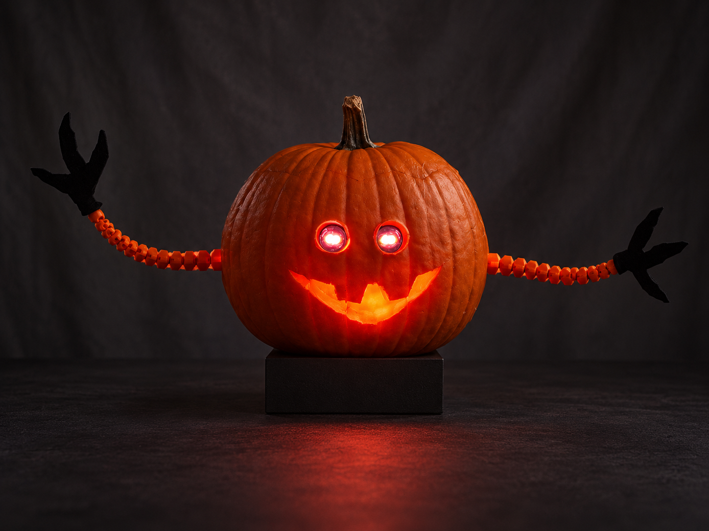 
  Hotová mechanická a elektronická zostava pred vložením do tekvice.

## Vyskúšajte si tekvicu online

Na stránke **[tekvica.premna.sk](https://tekvica.premna.sk)** je interaktívna 3D simulácia vytvorená podľa rovnakého kódu, aký beží v skutočnej tekvici. Môžete si otáčať scénu, spúšťať náhodné animácie alebo vybrať konkrétny gag a pozorovať oči, pohyb chápadiel aj svetelné efekty.

  <a href="https://tekvica.premna.sk">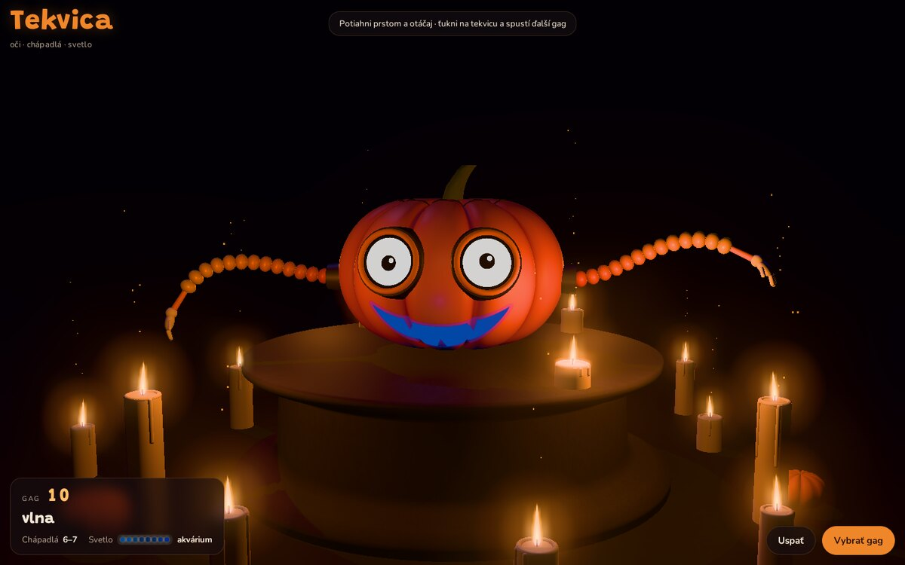</a> 
  Kliknutím na obrázok otvoríte interaktívnu ukážku na <a href="https://tekvica.premna.sk">tekvica.premna.sk</a>.

> [!CAUTION]
> Servá a LED pás majú samostatnú 5 V napájaciu vetvu. **Servá nenapájajte z 3V3 ani z VBUS pinu Pica.** Obe Pico sa napájajú **iba cez micro USB**, piny VBUS a VSYS ostávajú nezapojené. Všetky vetvy musia mať spoločnú zem. Pred prvým pohybom nechajte lanká voľnejšie a skúšajte vždy iba jedno servo.

## Obsah repozitára

| Adresár | Obsah |
|---|---|
| [`lib/oci`](lib/oci/) | firmvér Pico A: oči, RTC, animácie a UART |
| [`lib/ramena`](lib/ramena/) | firmvér Pico B: servá, gestá a svetlá |
| [`scad`](scad/) | parametrické OpenSCAD modely a vizualizácia zostavy |
| [`stl`](stl/) | hotové diely pripravené na 3D tlač |
| [`zapojenie`](zapojenie/) | schémy zapojenia a samostatné zoznamy elektroniky |
| [`obrazky`](obrazky/) | fotografie realizácie a náhľady 3D modelov |
| [`web`](web/) | samostatná interaktívna 3D simulácia projektu |

## Ako projekt funguje

Pico A ovláda dva SPI displeje. Zdieľajú signály SCK a MOSI, každý displej však má vlastné CS, DC, RST a PWM riadenie podsvietenia. Čas z DS3231 sa používa na denný a nočný režim. Animácie sa vyberajú náhodne, pričom sa žiadna nezopakuje skôr ako po 15 iných a matematický príklad (gag 42) príde pravidelne po každých 5–8 gagoch.

Pri spustení gagu Pico A odošle cez UART riadok s gestom (`G:...`) a svetelným efektom (`L:...`), po skončení gagu `G:NONE` a `L:CANDLE`. Niektoré gagy posielajú gesto až v konkrétnej chvíli – napríklad keď sa ukáže výsledok príkladu.

Pico B prijíma príkazy, plynulo riadi štyri servá MG90S (s rozbehom a dobehom, bez skokov) a vytvára efekty na osempixelovom páse WS2812. Bez nového príkazu sa gestá po 60 s a svetlá po 90 s samy vrátia do pokoja.

  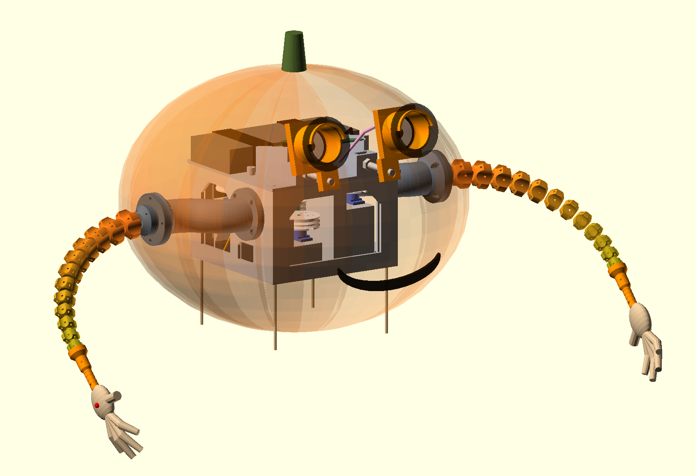
  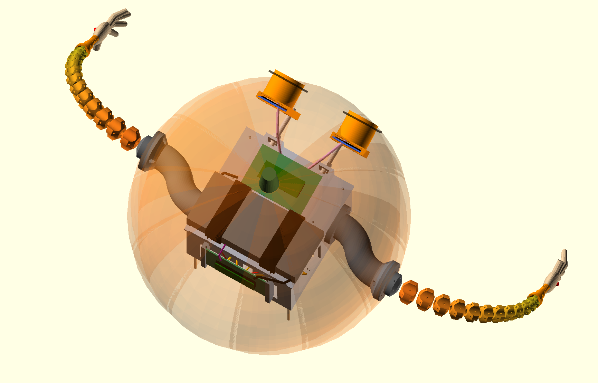 
  Vizualizácia umiestnenia mechaniky, elektroniky, očí a chápadiel v tekvici.

## Zoznam súčiastok

Podrobné elektronické zoznamy sú aj v súboroch [`pico_oci_suciastky.txt`](zapojenie/pico_oci_suciastky.txt) a [`pico_ramena_suciastky.txt`](zapojenie/pico_ramena_suciastky.txt).

### Elektronika

| Súčiastka | Počet | Použitie |
|---|---:|---|
| Raspberry Pi Pico 2 s kolíkmi | 2 | Pico A pre oči, Pico B pre ramená a svetlá |
| Dutinková lišta 1×20 | 4 | vyberateľné osadenie oboch Pico |
| Okrúhly TFT GC9A01, 1,28", 240×240, SPI | 2 | oči |
| RTC modul DS3231 + CR2032 | 1 | hodiny a nočný režim |
| Servo MG90S | 4 | dve osi každého chápadla |
| LED pás/modul 8× WS2812 („8-Bit 2812 RGB“) | 1 | svetelné efekty vo vnútri tekvice |
| Kondenzátor 470 µF | 5 | 4× napájacie lišty serv, 1× vetva očí |
| Rezistor 1 kΩ | 2 | sériovo v oboch UART vodičoch |
| Letovaný breadboard / univerzálna DPS | 2 | doska Pico A a Pico B |
| Trojpinový konektor | 1 | UART: GP0, GP1, GND |
| Kolíková lišta | 4× 3 piny | konektory serv |
| 2-pólová svorkovnica | 1 | prívod 5 V pre servá |
| Konektory pre TFT a RTC | podľa modulov | servisovateľné zapojenie |
| Powerbanka Xiaomi 20000 (2× USB-A) alebo ekvivalent | 1 | spoločný zdroj |
| USB-A vidlica na spájkovanie | 2 | kábel 1 (Pico) a kábel 2 (servá) |
| Micro USB vidlica na spájkovanie | 2 | napájanie Pico A a Pico B |

### Mechanika a spotrebný materiál

| Materiál | Orientačné množstvo | Poznámka |
|---|---:|---|
| PLA/PETG filament | podľa nastavenia tlače | krabica, segmenty, držiaky, oči a kladky |
| PU hadička 6×4 mm | 2× dĺžka chápadla + rezerva | pružná chrbtica chápadiel |
| PTFE trubička 4×2 mm | 8 trás + rezerva | vedenie laniek od serv |
| Pletená šnúra približne 0,25 mm | 8 trás + rezerva | ovládacie lanká |
| Filament 1,75 mm | krátke úseky | priečne poistné kolíky segmentov |
| Skrutky a matice M3 | podľa zostavy | základne, medzikusy, kladky a uchytenie |
| Tyč M8 alebo tlačená tyč M8 | 2 | polohovanie držiakov očí |
| Matica M8 | 4 | zaistenie očí |
| Dvojlinka 2× 0,15 mm² | približne 2 m | napájanie Pico (kábel 1) a signály |
| Dvojlinka 2× 0,5 mm² | približne 1 m | výkonová 5 V vetva serv (kábel 2) |
| Zmršťovacia bužírka, pásky, viazacie pásky | podľa potreby | izolácia a odľahčenie káblov |

## 3D tlač

Hotové STL sú pripravené v adresári [`stl/`](stl/). Počet kusov je uvedený priamo v názve súboru.

### Povinné diely

- [Chápadlo – 12 segmentov a palička, tlačiť 2×](stl/01_chapadlo_12_segmentov_a_palicka_tlacit_2x.stl)
- [Základňa chápadla, tlačiť 2×](stl/02_zakladna_chapadla_tlacit_2x.stl)
- Jeden typ medzikusu pre každé chápadlo:
  - [rovný 30 mm](stl/03_medzikus_rovny_30mm_tlacit_2x.stl),
  - [zahnutý 40°](stl/03b_medzikus_zahnuty_40st_tlacit_2x.stl), alebo
  - [vyosený S, 30 mm](stl/03c_medzikus_vyoseny_S_30mm_tlacit_2x.stl).
- [Kladka serva, tlačiť 4×](stl/04_kladka_tlacit_4x.stl)
- [Dno krabice](stl/05_krabica_dno_1x.stl)
- [Stena krabice s portom, tlačiť 2×](stl/06_krabica_stena_s_portom_tlacit_2x.stl)
- [Predná bočná stena](stl/07_krabica_predna_bocna_stena_1x.stl)
- [Zadná stena s lištami na Pico](stl/07b_krabica_zadna_stena_s_listami_na_pico_1x.stl)
- [Ľavý držiak oka](stl/13_oko_lave_tlaceny_zavit_1x.stl)
- [Pravý držiak oka](stl/13b_oko_prave_tlaceny_zavit_1x.stl)
- [Veko s nadstavcom očí a powerbanky](stl/14_veko_s_nadstavcom_oci_a_powerbanka_1x.stl)
- [Odtokový stĺpik](stl/16_odtokovy_stlpik_1x.stl)
- [Tlačená tyč očí M8, tlačiť 2×](stl/17_tyc_oci_M8_tlacit_2x.stl)
- [Tlačená matica M8, tlačiť 4×](stl/18_matica_M8_tlacena_tlacit_4x.stl)

### Testovacie a alternatívne diely

- [Test vybrania kladky](stl/04t_test_vybrania_hornu.stl)
- [Test držiaka serva](stl/09_test_drziak_serva_1x.stl)
- [Špička namiesto paličky, alternatíva](stl/12_spicka_namiesto_palicky_ALTERNATIVA_2x.stl)

Pred veľkou tlačou vytlačte test držiaka serva a test vybrania kladky. Rozmery lacných serv a ich hornov sa medzi výrobcami líšia. Odporúčané nastavenia tlače závisia od materiálu a tlačiarne; funkčné plochy, otvory pre lanká a závity po tlači očistite a skontrolujte nasucho.

  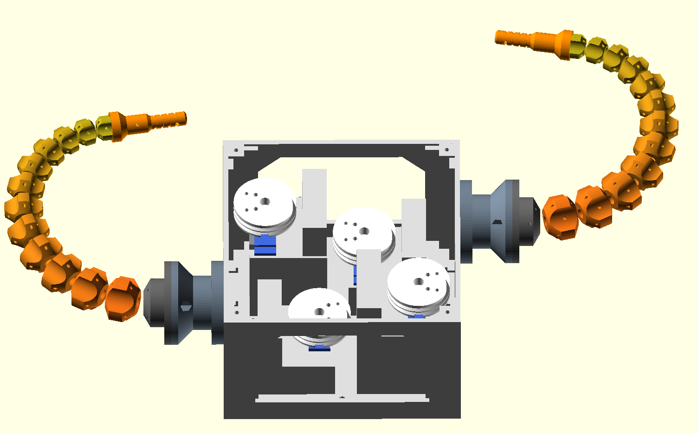
  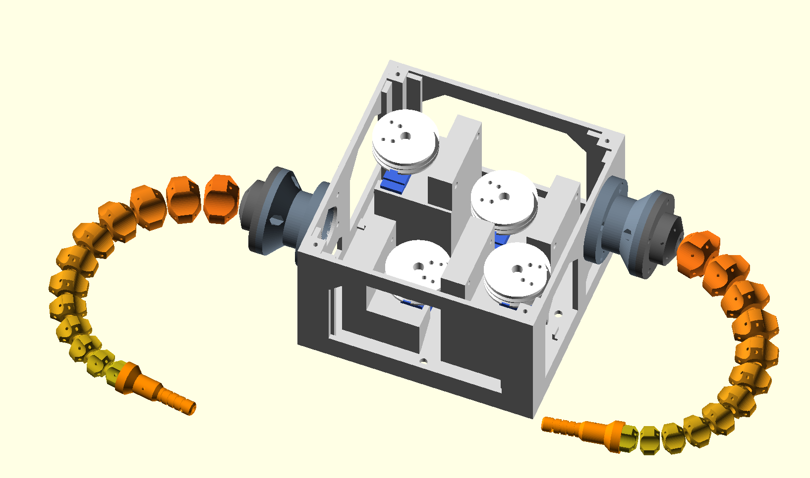 
  Parametrická mechanika chápadiel, krabica so servami, kladky a výmenné medzikusy.

## OpenSCAD zdroje

### [`scad/chapadlo.scad`](scad/chapadlo.scad)

Hlavný parametrický model. V hornej časti súboru sú skupiny nastavení pre chápadlo, chrbticu, lanká, koncovku, základňu, medzikus, kladku, servá, krabicu a oči.

Použitie:

1. Otvorte súbor v OpenSCAD.
2. V premennej `part` zvoľte diel, napríklad `segments_plate`, `base`, `pulley`, `spacer`, `box_floor`, `eye_deck` alebo `eye_pod`.
3. Podľa skutočných komponentov upravte rozmery, najmä `servo_body`, `servo_screw_spacing`, `horn_*`, `disp_pcb`, `rod_hole_d` a parametre medzikusu.
4. Náhľad vytvorte cez **F5**. Finálnu geometriu prepočítajte cez **F6**.
5. Použite **File → Export → Export as STL**.

Hodnota `part="assembly"` zobrazí mechanickú zostavu. Konzola OpenSCAD vypíše vypočítanú dĺžku chápadla, maximálny ohyb, potrebný ťah lanka a polomer kladky.

### [`scad/zostava_v_tekvici.scad`](scad/zostava_v_tekvici.scad)

Vizualizačný model celej zostavy. Načíta `chapadlo.scad`, pridá priehľadnú tekvicu, powerbanku, elektroniku, kabeláž, displeje a ruky. Slúži hlavne na kontrolu rozmiestnenia cez **F5**, nie na export jednotlivých tlačových dielov. Súbor `chapadlo.scad` musí zostať v rovnakom adresári.

Najdôležitejšie voľby sú `show_pumpkin`, `show_lid`, `pumpkin_r`, `pumpkin_h` a `arm_bend`. Referenčná realizácia používala tekvicu s priemerom približne **30 cm**; rozmery modelu upravte podľa konkrétnej tekvice ešte pred vyrezaním otvorov.

## Zapojenie

  <a href="zapojenie/pico_oci.png">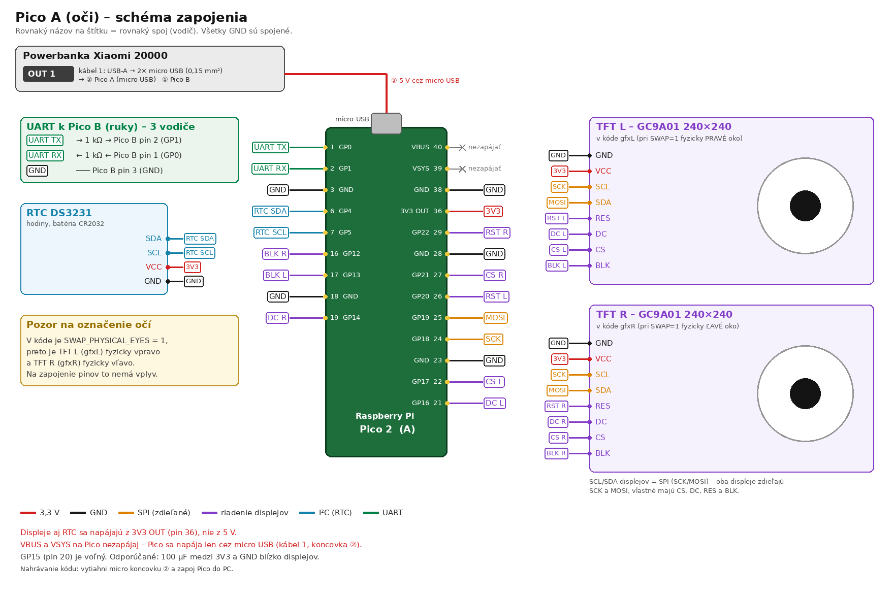</a>
  <a href="zapojenie/pico_ramena.png">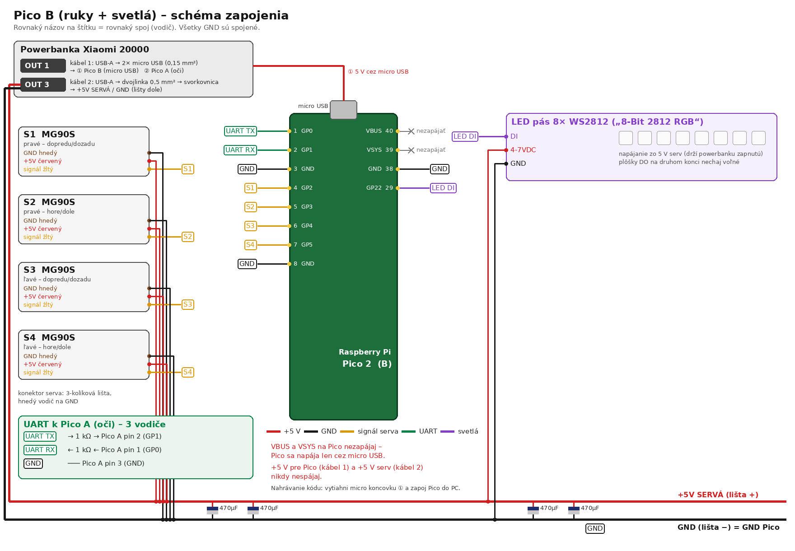</a> 
  Vľavo Pico A (oči a RTC), vpravo Pico B (servá a LED pás). Kliknutím otvoríte plné rozlíšenie.

### Prehľad pinov

| Pico A (oči) | Pin | | Pico B (ramená) | Pin |
|---|---|---|---|---|
| UART TX / RX | GP0 / GP1 | | UART TX / RX | GP0 / GP1 |
| RTC SDA / SCL | GP4 / GP5 | | S1 pravé – dopredu/dozadu | GP2 |
| SPI SCK / MOSI (oba displeje) | GP18 / GP19 | | S2 pravé – hore/dole | GP3 |
| TFT L: DC / CS / RST / BLK | GP16 / GP17 / GP20 / GP13 | | S3 ľavé – dopredu/dozadu | GP4 |
| TFT R: DC / CS / RST / BLK | GP14 / GP21 / GP22 / GP12 | | S4 ľavé – hore/dole | GP5 |
| Napájanie displejov a RTC | 3V3 OUT (pin 36) | | LED pás WS2812 DI | GP22 |

„Pravé“ a „ľavé“ chápadlo je pri pohľade na tekvicu spredu. Na Pico A musí ostať **GP26 voľný** – kód z neho pri štarte číta šum ako náhodné semienko pre výber gagov.

Medzi doskami použite krížený UART: TX jednej dosky ide cez 1 kΩ do RX druhej dosky a obe dosky majú spoločnú zem. Samostatná schéma je v [`prepojenie_pico.png`](zapojenie/prepojenie_pico.png).

Pri kóde očí je aktívne `SWAP_PHYSICAL_EYES=1`: vetva `gfxL` je na hotovej zostave fyzicky pravé oko a `gfxR` fyzicky ľavé. Zapojenie pinov sa tým nemení. Dôsledok: sériové príkazy `L±` a `R±` pre jas sú voči fyzickým očiam prehodené (na gagy to nemá vplyv, oči majú vždy rovnaký jas).

### Napájanie

| Výstup powerbanky | Kábel | Kam |
|---|---|---|
| OUT 1 (USB-A) | **kábel 1**: USB-A vidlica, v nej 2× dvojlinka 0,15 mm² s micro USB vidlicami | micro USB Pico A a Pico B |
| OUT 3 (USB-A) | **kábel 2**: USB-A vidlica, dvojlinka 0,5 mm² | svorkovnica → lišty serv (+5 V / GND), z nich aj LED pás |

- Na USB-A vidlici sú +5 V a GND krajné piny, na micro USB vidlici krajné piny strany s troma plôškami. **Polaritu pred prvým zasunutím do Pico overte multimetrom.**
- +5 V kábla 1 a +5 V kábla 2 sa nikdy nespájajú. Spoločná je iba zem – Pico B cez piny GND na lištu, Pico A cez GND v UART kábli.
- Na nahrávanie kódu vytiahnite micro USB vidlicu z Pico a zapojte ho do počítača bežným káblom. Servá môžu ostať napájané z powerbanky.

**Spotreba:** Pico, displeje a LED pás odoberajú trvalo približne 1–1,3 W, servá v priemere 0,3–0,5 W (hýbu sa len pri gestách). Powerbanka 20 000 mAh vydrží orientačne **35–40 hodín**. Trvalý odber cez 150 mA zároveň bráni tomu, aby sa powerbanka pri nečinnosti sama vypla.

## Denný a nočný režim

| Čas | Správanie |
|---|---|
| 05:30 | prebúdzanie: oči sa postupne otvoria a aktivujú |
| 05:30 – 21:45 | denná prevádzka: postupne sa spúšťajú náhodne vybrané animácie očí, gestá chápadiel a svetelné efekty |
| 21:45 – 22:00 | pomalé zaspávanie: oči čoraz častejšie klipkajú, viečka postupne klesajú a displeje sa stmievajú |
| 22:00 – 05:30 | úsporný režim: oči spia so zatvorenými viečkami a chápadlá sú vypnuté/nepohybujú sa; oči sa môžu iba občas krátko pootvoriť („peek“) |

Čas sa berie z DS3231. Ak RTC nemá správny čas, nastavte ho príkazom `T=HH:MM`. Od 21:45 systém plynulo prechádza do spánku a o 22:00 zastaví animácie aj pohyb chápadiel. Počas spánku Pico A nespúšťa gagy ani príkaz `G=číslo`. O 05:30 prebehne postupná animácia prebúdzania; po otvorení očí sa obnoví denný režim a následne sa v časových odstupoch spúšťajú náhodne vybrané animácie očí spolu s príslušnými gestami a svetlami.

## Zostavenie

1. **Overte rozmery.** Zmerajte servá, horn, displeje, powerbanku a vnútorný priestor tekvice. Podľa potreby upravte OpenSCAD parametre.
2. **Vytlačte testovacie diely.** Najprv overte uloženie serva a kladky.
3. **Vytlačte mechaniku.** Použite hotové STL alebo si diely exportujte z `chapadlo.scad`.
4. **Zostavte chápadlá.** Segmenty navlečte na PU chrbticu, poistite kúskami filamentu a prevlečte štyri lanká. Lanká veďte PTFE trubičkami k servám.
5. **Osaďte servá a kladky.** Pred uviazaním laniek nastavte všetky servá na stred 1500 µs. Lanká napnite rovnomerne bez predpätia, ktoré by preťažovalo servo.
6. **Zostavte oči.** Displeje vložte do ľavého a pravého držiaka, nasaďte ich na M8 tyče a až potom nastavte sklon.
7. **Zapojte elektroniku.** Postupujte podľa schém. Pred pripojením serv multimetrom overte 3,3 V a 5 V vetvu, polaritu USB vidlíc a spoločnú zem.
8. **Nahrajte firmvér a testujte.** Najprv samostatne Pico B bez napnutých laniek, potom Pico A s displejmi a RTC, nakoniec UART komunikáciu.
9. **Vložte zostavu do tekvice.** Zaistite odtok, odľahčite káble a elektroniku chráňte pred vlhkosťou a dužinou.

  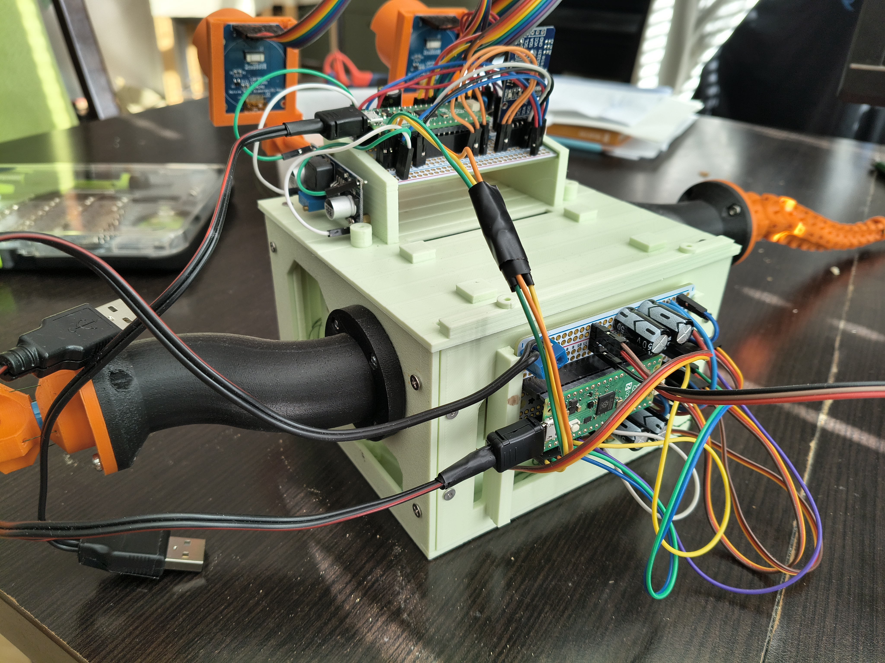
  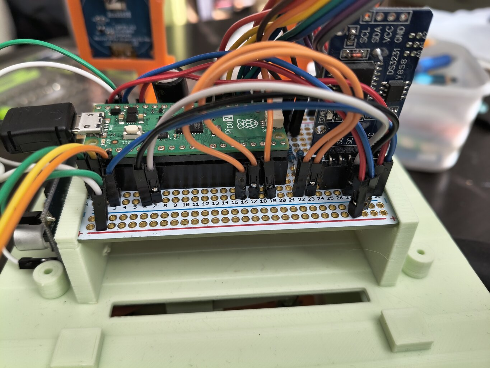
  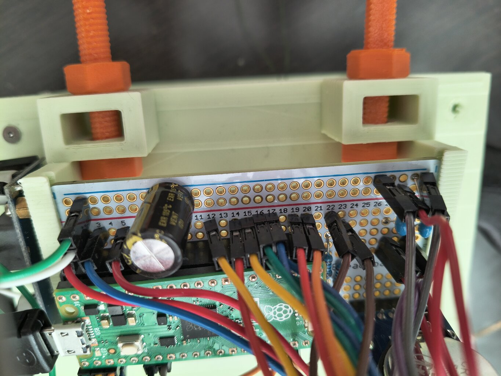 
  Reálna montáž: nosná krabica, doska Pico A s RTC a konektorová časť zapojenia.

## Kód a nahratie firmvéru

Projekt je určený pre Arduino IDE a jadro **Raspberry Pi Pico/RP2040/RP2350 od Earle F. Philhowera** (overené s verziou 6.3.0). Pre oba sketch-e vyberte dosku **Raspberry Pi Pico 2** a správny sériový port.

Potrebné knižnice (Nástroje → Spravovať knižnice):

- Pico A: **GFX Library for Arduino** (`Arduino_GFX_Library`); `Wire` je súčasťou jadra,
- Pico B: **Adafruit NeoPixel**; `Servo` a `hardware/gpio.h` dodáva Pico jadro.

Nahrajte:

1. [`lib/ramena/ramena.ino`](lib/ramena/ramena.ino) do Pico B,
2. [`lib/oci/oci.ino`](lib/oci/oci.ino) spolu s [`tekvica.h`](lib/oci/tekvica.h) do Pico A.

> [!TIP]
> Keď sú k počítaču pripojené obe dosky, pred každým nahratím skontrolujte **Nástroje → Port**. Pico A sa po štarte ohlási riadkom `Gags: G=0 .. G=52 …`, Pico B riadkom `Chapadla pripravene…`.

Oba sketch-e používajú **115200 baud** a príkazy ukončené novým riadkom.

### Testovanie Pico A – oči

V Serial Monitore nastavte 115200 baud a koniec riadku `Newline`.

| Príkaz | Význam |
|---|---|
| `T=HH:MM` alebo `T=HH:MM:SS` | nastaví čas; užitočné aj na prebudenie zo spánkového režimu |
| `STOP` | zastaví náhodné gagy, oči ďalej žmurkajú |
| `START` | obnoví náhodné gagy |
| `G=0` až `G=52` | spustí konkrétnu animáciu (vrátane gest a svetiel na Pico B) |
| `ANGRY` | spustí zlé šikmé oči |
| `DEMO` | prehrá rozsah nastavený cez `DEMO_FROM` a `DEMO_TO` |
| `DEMOALL` | prehrá gagy 16 až 52 |
| `PEEK` | počas spánku jedno pootvorenie očí |
| `L+`, `L-`, `L=0..255` | jas oka `gfxL` (fyzicky pravé) |
| `R+`, `R-`, `R=0..255` | jas oka `gfxR` (fyzicky ľavé) |
| `B+`, `B-`, `B=0..255` | jas oboch očí |

Na bežné testovanie odporúčame najprv poslať `STOP` a animácie spúšťať jednotlivo pomocou `G=číslo`. Bez `STOP` sa príkaz vykoná až po dokončení práve bežiaceho gagu. Pri testovaní mimo denného času nastavte čas príkazom `T=12:00`.

### Testovanie Pico B – ramená a svetlá

Pico B prijíma rovnaké príkazy cez USB Serial aj cez UART z Pico A. Gestá majú aj slovenské skratky.

| Príkaz | Skratka | Význam |
|---|---|---|
| `S=2`, `S=3`, `S=4`, `S=5` | | diagnosticky pohne jedným servom o +300 µs a vráti ho do stredu |
| `G:NONE` | `ZIADNE` | návrat do pokoja |
| `G:WAVE` | `MAVAJ` | mávanie |
| `G:UP` | `HORE` | ruky hore, pohupovanie |
| `G:UNDULATE` | `VLNENIE` | vlnenie |
| `G:CHEER` | `HEJ` | „hej-hou“ – obe ruky naraz hore-dole |
| `G:CHEER2` | `HURA` | „hurá-hurá“ – ruky striedavo hore-dole |
| `G:GREET` | `POZDRAV` | pravá ruka dopredu, ľavá máva |
| `G:SIX7` | `67` | gesto 6–7: predpažené, striedavo hore-dole |
| `G:EIGHT` | `OSMICKA` | ležatá osmička |
| `G:CIRCLE` | `KRUH` | krúženie smerom dopredu |
| `G:REACH` | `NACAHNI` | načahovanie dopredu |
| `G:SHAKE` | `KMITAJ` | rýchle kmitanie |
| `G:ZOMBIE` | `ZOMBIK` | natiahnuté dopredu, striedavo hore-dole |
| `G:RIPPLE` | `VLNKY` | vlnky vody |
| `G:SWIM` | `PLAVAJ` | plávanie prsia |
| `L:CANDLE`, `L:RED`, `L:FIRE`, `L:SUN` | | sviečka, červené pulzovanie, oheň, slnko |
| `L:PURPLE`, `L:DARK`, `L:BLUE`, `L:GREEN` | | fialová vlna, tma, vodné vlnky, sliz |
| `L:LIGHTNING`, `L:RAINBOW`, `L:PINK`, `L:SCANNER` | | blesky, dúha, tlkot srdca, skener |
| `L:NIGHT`, `L:FIREWORKS`, `L:BLINK`, `L:REDBLINK` | | hviezdy, ohňostroj, oslavné a červené blikanie |

Bez pripojených laniek spustite postupne `S=2` až `S=5` a zapíšte si, ktoré chápadlo (pri pohľade spredu) a ktorým smerom sa pohne. Ak je smer gesta opačný, upravte príslušnú hodnotu poľa `SIGN`. Stredy serv nastavte v poli `center`. Až potom pripojte a napnite lanká. Maximálnu odchýlku chráni konštanta `LIMIT`.

### Test UART prepojenia

1. Spojte dosky podľa [`prepojenie_pico.png`](zapojenie/prepojenie_pico.png).
2. Pripojte obe dosky k napájaniu a otvorte Serial Monitor Pico A.
3. Pošlite `STOP` a následne napríklad `G=16`.
4. Pico A vykreslí gag a odošle zodpovedajúce riadky `G:...` a `L:...` do Pico B (ruky hore, červené svetlo).
5. Ak oči fungujú, ale ramená alebo svetlá nereagujú, skontrolujte kríženie TX/RX, oba 1 kΩ rezistory, 115200 baud a spoločnú zem.

## Prehľad gagov

Gesto a svetlo, ktoré Pico A pošle pri každom gagu. Priradenie sa mení v tabuľkách `gagGesture` a `gagLight` v `oci.ino`.

| G= | Náhľad očí | Gag | Chápadlá | Svetlo |
|---:|---|---|---|---|
| 0 | 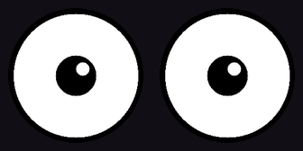 | pohľad dopredu | – | sviečka |
| 1 |  | pohľad vľavo hore | na konci pozdrav | sviečka |
| 2 |  | pohľad vpravo hore | – | sviečka |
| 3 |  | dve zrenice v jednom oku | – | sviečka |
| 4 |  | kvetina | osmička | dúha |
| 5 |  | mačacie oči | ruky hore | zelená |
| 6 |  | arkanoid | osmička | dúha |
| 7 |  | pumpovanie zreníc | – | sviečka |
| 8 |  | hypno špirála | vlnenie | fialová |
| 9 |  | skákajúce oči | načahovanie | sviečka |
| 10 |  | vlna | 6–7 | modrá |
| 11 |  | vyľakané pohľady | ruky hore | sviečka |
| 12 |  | dýchanie zrenice | – | sviečka |
| 13 |  | osmička | osmička | sviečka |
| 14 |  | tekvičky | – | oheň |
| 15 |  | Halloween nápis | – | oheň |
| 16 |  | zlé šikmé oči | ruky hore | červená |
| 17 |  | srdiečka | – | srdce |
| 18 |  | prekvapené | kmitanie | slnko |
| 19 |  | K.O. | – | slnko |
| 20 |  | škúlenie | – | sviečka |
| 21 |  | smutné so slzami | – | modrá |
| 22 |  | krvavé žilky | ruky hore | červená |
| 23 |  | pavúk | – | fialová |
| 24 |  | netopiere | – | fialová |
| 25 |  | ohnivé oči | ruky hore | oheň |
| 26 |  | robot – skener | – | skener |
| 27 |  | zombie | vlnenie | zelená |
| 28 |  | sliz | zombík | zelená |
| 29 |  | noc – mesiac a hviezdy | – | noc |
| 30 |  | akvárium | plávanie prsia | modrá |
| 31 |  | hracie automaty | – | dúha |
| 32 |  | blesky | ruky hore | blesky |
| 33 |  | kyklop | – | sviečka |
| 34 |  | čarodejnica | – | fialová |
| 35 |  | radar | – | zelená |
| 36 |  | sviečka v oku | – | sviečka |
| 37 |  | chápadlá v oku | osmička | fialová |
| 38 |  | upír | ruky hore | červená |
| 39 |  | vlkolak | – | noc |
| 40 |  | kľúčová dierka | – | tma |
| 41 |  | papuľa | ruky hore | červená |
| 42 |  | matematický príklad | pri výsledku hej-hou | slnko, pri výsledku blikanie |
| 43 |  | koľko je hodín? | pri čase hej-hou | slnko, pri čase blikanie |
| 44 |  | portály | – | modrá |
| 45 |  | obrie oko | zombík | sviečka |
| 46 |  | dračie oči | zombík | oheň |
| 47 |  | červené oči v tme | ruky hore | červené blikanie |
| 48 |  | plamenné oči | ruky hore | oheň |
| 49 |  | six-seven | 6–7 pri číslach | dúha |
| 50 |  | autíčko s loopingom | krúženie dopredu | slnko |
| 51 |  | odpočet a ohňostroj | pri výbuchu hurá-hurá | ohňostroj |
| 52 |  | tekvička a kanál | – | sviečka |

## Prispôsobenie

Najčastejšie upravované konštanty:

| Súbor | Konštanta | Význam |
|---|---|---|
| `oci.ino` | `gagGesture[]`, `gagLight[]` | ktoré gesto a svetlo patrí ku gagu |
| `oci.ino` | `RECENT_N`, `QUIZ_EVERY_MIN/MAX` | koľko gagov sa neopakuje, ako často príde príklad |
| `oci.ino` | `SWAP_PHYSICAL_EYES` | prehodenie ľavého a pravého displeja |
| `oci.ino` | `WK_STYLE`, `WK_PASSES` | postavička a počet kôl v gagu 52 |
| `ramena.ino` | `SIGN[]`, `center[]` | smer a stred každého serva |
| `ramena.ino` | `LIMIT` | maximálna výchylka od stredu (ochrana laniek) |
| `ramena.ino` | `MAX_SPEED`, `MAX_ACC` | plynulosť pohybu (rýchlosť, zrýchlenie) |
| `ramena.ino` | `LIFT_GAIN[]`, `SWING_GAIN[]` | zosilnenie pohybu pre každé chápadlo zvlášť |
| `ramena.ino` | `ARMS_SYNC` | ruky sa hýbu spolu alebo v protifáze |
| `ramena.ino` | `UP_*`, `WAVE_*`, `CHEER_*`, `SIX7_*`, `ZOMB_*`, `SWIM_KEY` … | veľkosť a rýchlosť jednotlivých gest |
| `ramena.ino` | `STICK_BRIGHT` | jas LED pásu |
| `ramena.ino` | `IDLE_MOVE` | jemný pohyb chápadiel aj v pokoji (vyšší odber) |

Smerom dole idú chápadlá vo všetkých gestách len do polovice výchylky, aby neudierali do podložky.

## Riešenie problémov

| Príznak | Príčina a riešenie |
|---|---|
| `Neznamy prikaz: G=42` | Serial Monitor je pripojený na Pico B. Prepnite port na Pico A. |
| `G=číslo` nič nerobí | Chýba koniec riadku `Newline`, práve beží iný gag (pošlite `STOP`) alebo oči spia (`T=12:00`). |
| `Oci spia - gag sa nespusti` | Je nočný režim podľa RTC. Nastavte čas `T=HH:MM`. |
| `Adafruit_NeoPixel.h: No such file` | Nainštalujte knižnicu Adafruit NeoPixel. |
| `Multiple libraries were found for "Servo.h"` | Len upozornenie, použije sa správna knižnica z Pico jadra. |
| Chápadlo ide opačným smerom | Otočte znamienko v `SIGN[]` pre dané servo (zistíte cez `S=2…5`). |
| Jedno chápadlo sa hýbe menej | Zvýšte jeho `LIFT_GAIN` alebo `SWING_GAIN`, prípadne skontrolujte napnutie lanka. |
| Servá pri zapnutí skočia | Servo nevie povedať, kde stojí – skok nastane pri prvom pripojení. Pred vypnutím nechajte ruky v strede. |
| Pico sa reštartuje pri pohybe serv | Servá sú na rovnakom zdroji ako Pico alebo chýbajú kondenzátory 470 µF. |
| LED pás bliká náhodnými farbami | Dlhý dátový vodič – skráťte vodič DI (3,3 V signál do 5 V pásu). |
| Powerbanka sa vypína | Skontrolujte, či svieti LED pás a displeje (trvalý odber). Prípadne zapnite `IDLE_MOVE`. |

## Bezpečnosť a prevádzka

- Počas prvých testov nepúšťajte ruky ani vlasy k chápadlám a kladkám.
- Neprekračujte bezpečný rozsah serv. Pri bzučaní alebo zahrievaní okamžite vypnite napájanie a povoľte lanká.
- Elektroniku chráňte pred vodou. Čerstvá tekvica kondenzuje a môže tiecť.
- Powerbanku a káble upevnite tak, aby sa nemohli dostať do pohyblivej mechaniky.
- Pred skladovaním vyberte RTC batériu a odpojte powerbanku.

## Prispievanie a licencia

Postup pre zmeny je v [`CONTRIBUTING.md`](CONTRIBUTING.md). Projekt je distribuovaný pod [Apache License 2.0](LICENSE). Licencia povoľuje používanie, úpravy, distribúciu aj komerčné využitie kódu, dokumentácie a modelov za podmienok uvedených v licencii. Pri ďalšej distribúcii zachovajte licenčné a autorské oznámenia a označte upravené súbory.
